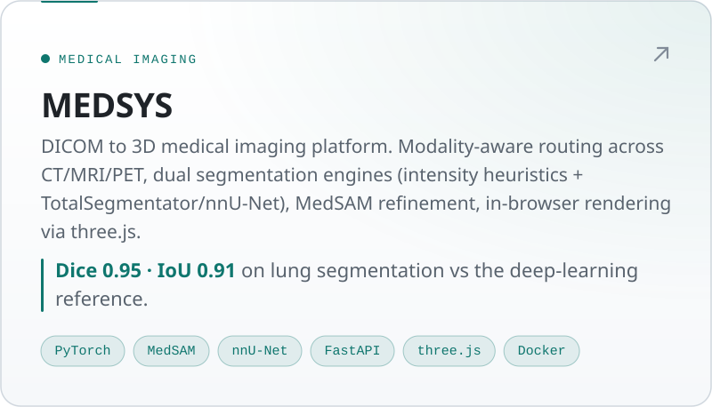
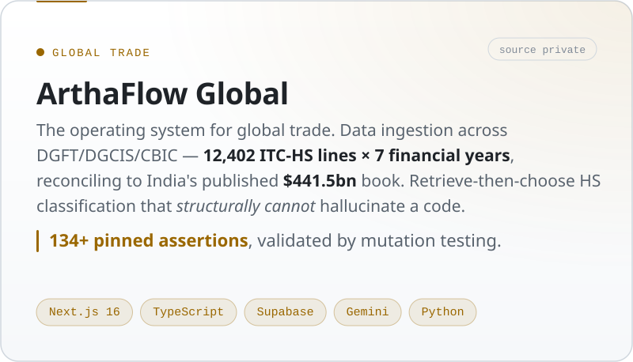
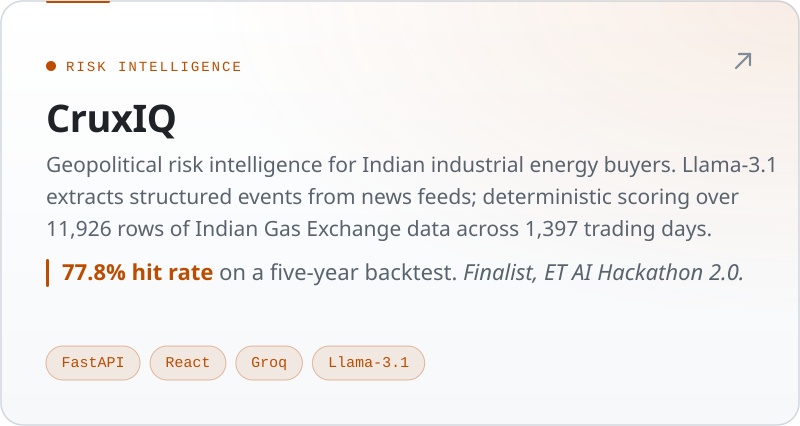
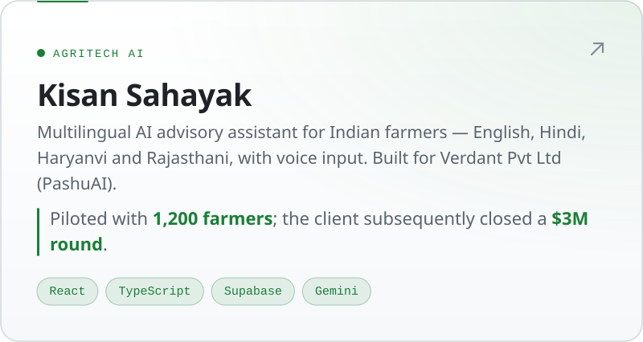
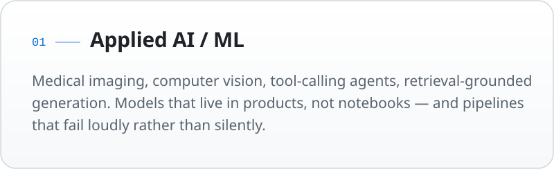
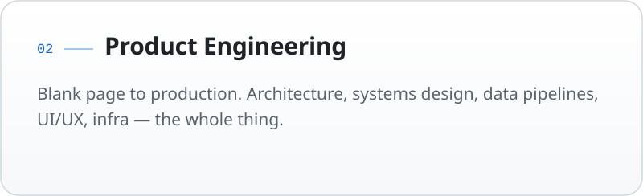
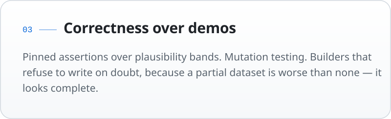
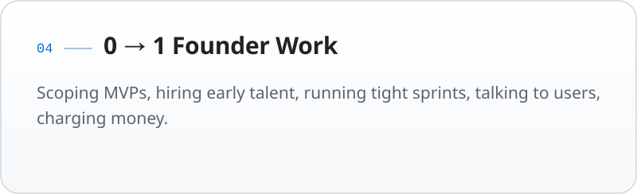

<!-- Header -->
<div align="center">

<picture><source media="(prefers-color-scheme: dark)" srcset="assets/header-dark.svg"></picture>

<a href="https://git.io/typing-svg">
  
</a>

<br/>

<a href="https://www.linkedin.com/in/sarthak-wage-993b5a282/">
  
</a>
<a href="https://arthaflowglobal.com">
  
</a>
<a href="https://www.meshcraftassets.com">
  
</a>


</div>

<br/>

## 👨‍💻 &nbsp; About me

```yaml
name:       Sarthak Wage
role:       Co-founder @ ArthaFlow Global
previously: Founder & CTO @ MeshCraft (Rs 22L revenue, Rs 50L seed, 8-person team)
focus:      Applied ML · Medical imaging · LLM agents · Full-stack
location:   Mumbai, India 🇮🇳
mindset:    Problem-first, lane-agnostic, ship fast
philosophy: "If it doesn't ship, it doesn't exist."
fueled_by:  Endurance cycling, hard problems, and good design
```

> I'm a builder who doesn't believe in picking a lane. One week it's a medical segmentation
> pipeline, the next it's a tool-calling agent over trade data. **Curiosity is my stack.**

<br/>

## 🚢 &nbsp; Selected work

<p align="center">
<a href="https://github.com/Organic42/MEDSYS"><picture><source media="(prefers-color-scheme: dark)" srcset="assets/card-medsys-dark.svg"></picture></a>
<a href="https://arthaflowglobal.com"><picture><source media="(prefers-color-scheme: dark)" srcset="assets/card-arthaflow-dark.svg"></picture></a>
</p>
<p align="center">
<a href="https://github.com/Organic42/team-men-in-market-et-hackathon"><picture><source media="(prefers-color-scheme: dark)" srcset="assets/card-cruxiq-dark.svg"></picture></a>
<a href="https://github.com/Organic42/PashuAI_V1"><picture><source media="(prefers-color-scheme: dark)" srcset="assets/card-kisan-dark.svg"></picture></a>
</p>

<br/>

## ⚡ &nbsp; What I'm great at

<p align="center">
<picture><source media="(prefers-color-scheme: dark)" srcset="assets/tile-ai-dark.svg"></picture>
<picture><source media="(prefers-color-scheme: dark)" srcset="assets/tile-product-dark.svg"></picture>
</p>
<p align="center">
<picture><source media="(prefers-color-scheme: dark)" srcset="assets/tile-correctness-dark.svg"></picture>
<picture><source media="(prefers-color-scheme: dark)" srcset="assets/tile-founder-dark.svg"></picture>
</p>

<br/>

## 🛠️ &nbsp; Tech I actually ship with

<div align="center">

**ML / AI**

`PyTorch` · `MedSAM (fine-tuning)` · `nnU-Net / TotalSegmentator` · `SAM` · `DeepLabV3+` · `LangGraph` · `FAISS` · `RAG` · `Gemini` · `Claude` · `Llama-3.1`

**Medical imaging & 3D**

`SimpleITK` · `pydicom` · `OpenCV` · `scikit-image` · `PyVista` · `VTK` · `three.js`

**Languages**


**Frameworks & Data**


**Tools & Platforms**


</div>

<br/>

## 📊 &nbsp; The numbers

<div align="center">


<br/><br/>


&nbsp;&nbsp;


</div>

<br/>

## 🧠 &nbsp; How I think

<div align="center">

| Principle | What it looks like in practice |
| :--- | :--- |
| 🎯 **Problem > Stack** | The right tool depends on the problem, not the trend |
| ⚡ **Ship, then polish** | A live v0.1 beats a perfect plan in a notebook |
| 🧩 **Generalist by design** | Depth is great. Range is leverage. |
| 🛡️ **Never fabricate** | If the data is unavailable, say so — don't fill the gap with a plausible guess |
| 🛠️ **Craft is non-negotiable** | If users feel the bug, the code is wrong |
| 🤝 **Build with people, not for them** | Talk to users. Often. |

</div>

<br/>

## 🐍 &nbsp; Contribution graph

<div align="center">
<picture><source media="(prefers-color-scheme: dark)" srcset="https://raw.githubusercontent.com/Organic42/Organic42/output/github-contribution-grid-snake-dark.svg"></picture>
</div>

<br/>

<div align="center">
<picture><source media="(prefers-color-scheme: dark)" srcset="assets/footer-dark.svg"></picture>
</div>
